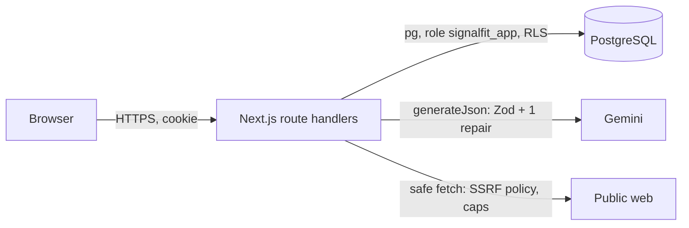

# SignalFit architecture

Status: describes what exists in the repository on 2026-10-23. Items under "Not built" are plans, not features.

## Context

One web application (Next.js 14, Node runtime) talks to three external systems: PostgreSQL (all state), Google Gemini (four bounded structured tasks) and the public web (fetched page text). There is no background worker, queue or cache; every long task is a short HTTP stage called by the browser.

## Containers and responsibilities

| Area | Files | Owns |
|---|---|---|
| Identity | `lib/auth.ts`, `app/api/auth/*` | bcrypt, hashed sessions, TOTP (AES-GCM secret), AAL1/AAL2 |
| Request guards | `lib/guard.ts` | same-origin check, fixed-window rate limits (`auth_attempts`) |
| Data access | `lib/db.ts` | `withUser` (RLS owner context), `withAuth` (pre-session only) |
| Interview | `lib/interview.ts`, `lib/followups.ts`, `app/api/interview/*` | question order, limits (max 10), model follow-ups |
| Profile | `app/api/profile/*`, `lib/gemini.ts` | synthesis, versions, confirmation with unknown acknowledgement |
| Research | `lib/research.ts`, `app/api/research/run/*` | safe fetch, staged collect/extract/match/critique |
| Grounding | `lib/validator.ts`, `lib/matching.ts` | citation resolution, recency, eligibility, weighted score |
| AI boundary | `lib/ai.ts` | the only place models are called; schemas, repair, timeout, fallback models |
| Shortlist | `app/api/opportunities/*`, `app/api/saved` | save/dismiss/notes, Markdown export |

## Data ownership

Every private table carries `owner_id` directly or through `research_runs`. Policies read `app.user_id`, set per transaction by `withUser`. The application role cannot bypass RLS. The model never writes to the database; routes validate model output, then persist it.

## Stage state machine (research)

`collection -> extraction -> matching -> critique -> review`. Each stage commits before returning. A failed model call sets `status='error'` and an error message, leaves earlier rows intact, and the same stage can be called again. Evidence rows are unique per (run, canonical URL), so a retry never refetches stored pages.

## Failure modes

| Failure | Behaviour |
|---|---|
| Model 503 / timeout / quota | up to 3 attempts, rotating `GEMINI_FALLBACK_MODELS`; then retryable 502 |
| Invalid structured output | Zod validation, one repair prompt, then retryable 502 |
| Source blocked or script-rendered | stored as `unavailable`; lowers coverage |
| Model cites unknown or foreign id | rejected by `validateCitations`; candidate dropped if no valid citation remains |
| Browser closed mid-run | run keeps last committed stage; "Resume run" continues |

## Not built

Email verification and recovery codes, scheduled monitoring, outreach, CRM, deployment configuration, DNS pinning against rebinding between check and fetch, side-by-side comparison.

## Decisions

See `adr/`.
